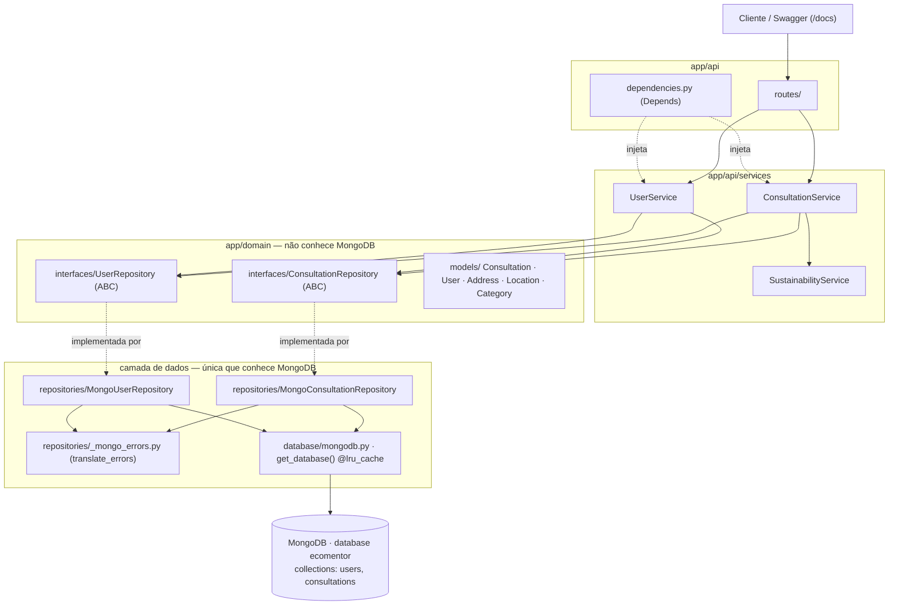
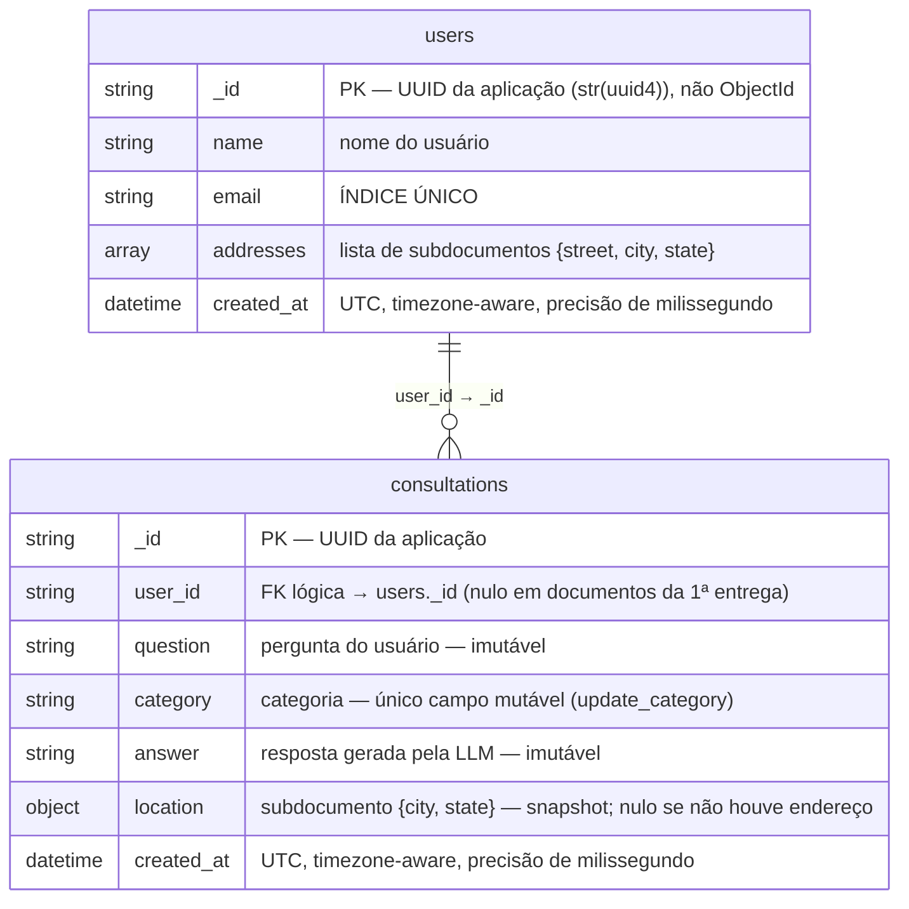

# MongoDB no EcoMentor

Documentação da camada de dados do backend na **2ª entrega**: duas coleções (`users` e `consultations`), relacionamento entre elas e documentos com objetos aninhados. Organizado por tópico, com o porquê de cada decisão.

## 1. Visão geral

O backend usa MongoDB como único banco (database `ecomentor`) com **duas coleções**:

| Coleção | Conteúdo | Objetos complexos |
|---|---|---|
| `users` | Pessoas que fazem perguntas | `addresses`: **lista de subdocumentos** `{street, city, state}` |
| `consultations` | Consultas já respondidas pela LLM | `location`: **subdocumento** `{city, state}` |

O relacionamento é por **referência**: `consultations.user_id` aponta para `users._id`.

Arquitetura em camadas, de fora para dentro:

```
app/api/routes/          -> endpoints FastAPI
app/api/dependencies.py  -> composition root (liga interfaces às implementações)
app/api/services/        -> regra de negócio (ConsultationService, UserService, SustainabilityService)
app/domain/interfaces/   -> contratos abstratos (não sabem que MongoDB existe)
app/domain/models/       -> entidades (Consultation, User, Address, Location, Category)
app/api/repositories/    -> implementação concreta sobre MongoDB
app/database/            -> conexão com o MongoDB
```



O domínio (`app/domain/`) não importa nada de `pymongo`. Só `repositories/` e `database/` sabem que o banco é MongoDB: isso permite trocar de banco sem tocar em regra de negócio e testar a regra sem um banco de verdade.

## 2. Modelagem dos documentos

### Coleção `users`

Arquivo do modelo: `app/domain/models/user.py`.

```json
{
  "_id": "uuid-gerado-pela-aplicacao",
  "name": "Ana Souza",
  "email": "ana.souza@email.com",
  "addresses": [
    { "street": "Rua das Flores, 100", "city": "Maringá", "state": "PR" },
    { "street": "Av. Brasil, 500", "city": "Curitiba", "state": "PR" }
  ],
  "created_at": "2026-01-10T12:00:00+00:00"
}
```

### Coleção `consultations`

Arquivo do modelo: `app/domain/models/consultation.py`.

```json
{
  "_id": "uuid-gerado-pela-aplicacao",
  "user_id": "uuid-do-usuario",
  "question": "Posso jogar óleo de cozinha na pia?",
  "category": "residuos",
  "answer": "Não. Guarde o óleo usado em uma garrafa PET e leve a um ponto de coleta.",
  "location": { "city": "Maringá", "state": "PR" },
  "created_at": "2026-01-11T12:00:00+00:00"
}
```

### Diagrama entidade-relacionamento



Categorias válidas (`app/domain/models/category.py`): `residuos`, `agua`, `energia`, `consumo`, `geral`.

As coleções são criadas de forma *lazy*: o MongoDB só as materializa no primeiro `insert_one`. Os índices são criados no `__init__` de cada repositório (idempotente).

## 3. Relacionamento e objetos complexos

### Por que referência (`user_id`) e não embutir as consultas no usuário?

- As consultas de um usuário **crescem sem limite** com o uso. Embutir tudo num único documento esbarraria no limite de 16 MB do MongoDB e tornaria cada leitura do usuário cada vez mais pesada.
- As consultas são lidas e filtradas **de forma independente** (por categoria, por data, paginadas, agregadas), o que é natural numa coleção própria com índices próprios.
- A referência mantém `users` pequena e estável.

### Por que embutir os endereços (`addresses`) no usuário?

- São **poucos** (limitados na prática a algumas unidades por pessoa).
- São **sempre lidos junto** com o usuário: não há caso de uso que busque um endereço sozinho.
- Uma só leitura traz o usuário completo, sem `$lookup` nem segunda consulta, e a escrita de um endereço novo é atômica no documento (`$push`).

### Por que `location` na consulta é um snapshot?

A consulta guarda **a cidade/estado usados na resposta**, copiados do endereço do usuário no momento da pergunta. Se o usuário mudar de endereço depois, o histórico continua correto: a resposta foi gerada para aquela cidade. Se o usuário não tiver endereço, `location` fica `null`.

### Integridade referencial

O MongoDB não tem chave estrangeira. A integridade é garantida **pela aplicação**:

- **Criar** consulta exige usuário existente; caso contrário, o serviço levanta `NotFoundError` (HTTP 404). *(Regra do `ConsultationService`, tarefa "ConsultationService com usuário, localização e classificação" do Kanban; atualizar esta nota quando entrar no `main`.)*
- **Remover** usuário apaga as consultas dele em cascata (`UserService.delete_user` → `ConsultationRepository.delete_by_user`). A ordem é proposital: as consultas saem **antes** do usuário, então uma falha no meio deixa no máximo um usuário sem consultas, nunca consultas órfãs (o MongoDB standalone não oferece transações multi-documento sem replica set).

### Compatibilidade com a 1ª entrega

`user_id` e `location` são opcionais (`None`) no modelo e lidos com `document.get(...)` no repositório. Documentos antigos, sem esses campos, continuam legíveis (há teste para isso).

## 4. Índices

| Coleção | Índice | Tipo | Para quê |
|---|---|---|---|
| `users` | `email` | **único** | Impede e-mail duplicado; a violação vira `ConflictError` (HTTP 409) |
| `users` | `created_at: -1` | simples | Listagem de usuários, mais recentes primeiro |
| `consultations` | `created_at: -1` | simples | Listagem geral ordenada |
| `consultations` | `category: 1, created_at: -1` | composto | Filtro por categoria + ordenação |
| `consultations` | `user_id: 1, created_at: -1` | composto | Histórico de um usuário, cascata e agregação por categoria |

Além do índice automático em `_id`.

## 5. Identidade e datas

- O `_id` recebe o mesmo `id` gerado pela entidade de domínio (`str(uuid4())`), em vez de um `ObjectId`: evita dois identificadores para o mesmo registro e evita importar `bson` no domínio.
- `created_at` é sempre `datetime` **timezone-aware** (`datetime.now(timezone.utc).replace(microsecond=0)`). O BSON guarda datas em UTC com precisão de milissegundo; truncar o microssegundo na origem mantém o round-trip `save`/`get_by_id` idempotente.

## 6. Driver e conexão

Arquivo: `app/database/mongodb.py`.

- Driver: **PyMongo síncrono**, não Motor. As interfaces de repositório são síncronas, e o FastAPI roda rotas `def` numa threadpool sem travar o event loop; para esta PoC é suficiente e evita complexidade desproporcional.
- `get_database()` é um singleton via `@lru_cache` (mesmo idioma de `core/config.py:get_settings()`). O `MongoClient` já gerencia seu pool de conexões.
- `tz_aware=True`: sem isso o PyMongo devolve datas naive, perdendo a característica definida na modelagem.
- `serverSelectionTimeoutMS=5000`: sem isso o default é 30 s, e um Mongo fora do ar faria qualquer requisição travar 30 s antes de virar erro 503.

`GET /health` faz `client.admin.command("ping")`: responde `{"status": "ok"}` ou **503** se o `ping` levantar `PyMongoError`.

## 7. Operações implementadas

### `MongoUserRepository` (`app/api/repositories/mongo_user_repository.py`)

| Método | Operação MongoDB |
|---|---|
| `save(user)` | `insert_one`; `DuplicateKeyError` → `ConflictError("E-mail já cadastrado.")` |
| `get_by_id(user_id)` | `find_one({"_id": ...})`; `None` se não existir |
| `list_all(limit, skip)` | `find().sort("created_at", -1).skip().limit()` |
| `add_address(user_id, address)` | `find_one_and_update` com `$push` em `addresses` e `ReturnDocument.AFTER` (atômico); `None` se o usuário não existir |
| `delete(user_id)` | `delete_one`; `True`/`False` |

### `MongoConsultationRepository` (`app/api/repositories/mongo_consultation_repository.py`)

| Método | Operação MongoDB |
|---|---|
| `save(consultation)` | `insert_one` (inclui `user_id` e o subdocumento `location`) |
| `list_all(category, user_id, limit, skip)` | `find(filtros).sort("created_at", -1).skip().limit()` |
| `get_by_id(id)` | `find_one`; `None` se não existir |
| `update_category(id, category)` | `find_one_and_update` com `$set` e `ReturnDocument.AFTER`. Só `category` muda: `question` e `answer` são um fato histórico |
| `delete(id)` | `delete_one` |
| `delete_by_user(user_id)` | `delete_many({"user_id": ...})`; devolve quantas foram removidas (cascata) |
| `count_by_category(user_id)` | **agregação** (ver abaixo) |

### Agregação por categoria

```python
[
    {"$match": {"user_id": user_id}},
    {"$group": {"_id": "$category", "total": {"$sum": 1}}},
    {"$sort": {"total": -1, "_id": 1}},
]
```

Resultado, por exemplo: `{"residuos": 2, "agua": 1}`. É o "impacto" do usuário por tema (ODS 12) e usa o índice `user_id + created_at` no `$match`.

### Mapeamento e erros

- O mapeamento documento ↔ entidade é manual (`_to_document` / `_to_entity`), sem ODM: são poucos campos, e uma dependência extra de mapeamento não se paga.
- O decorator `translate_errors` (`app/api/repositories/_mongo_errors.py`) é **compartilhado** pelos dois repositórios e converte qualquer `PyMongoError` em `RepositoryError` (HTTP 503). Erros de "não encontrado" continuam sinalizados por retorno (`None`/`False`); a decisão de responder 404 fica no serviço. O `DuplicateKeyError` é tratado **antes**, dentro do `save` de usuário, para virar erro de regra de negócio (409) e não falha de infraestrutura.

> **Exposição pela API:** as rotas de consultas já existem em `app/api/routes/consultations.py`. As rotas de usuários, histórico e resumo por categoria são o escopo da tarefa do Kanban "Endpoints de usuários, histórico e resumo" e devem ser listadas aqui quando entrarem no `main`.

## 8. Dados de demonstração

`backend/scripts/seed.py` popula o banco com 2 usuários (um com 2 endereços) e 5 consultas relacionadas, usando os próprios repositórios. É idempotente (ids e e-mails fixos) e não chama a LLM.

```powershell
cd backend
python -m scripts.seed
```

## 9. Estratégia de testes

- **Unitários** (`tests/unit/test_mongo_user_repository.py`, `test_mongo_consultation_repository.py`, `test_mongo_errors.py`, `test_seed.py`): usam `mongomock`, que simula o PyMongo em memória. Cobrem índice único, `$push`, filtro por usuário, agregação, documento legado e tradução de erros.
- **Integração** (`tests/integration/test_mongodb.py`): rodam contra um MongoDB real, usando o banco **separado** `ecomentor_test` (nunca o de desenvolvimento), limpando as coleções `users` e `consultations` depois de cada teste. Validam o índice único, o `$push`, a referência `user_id` + `location`, o `$group` e a cascata de remoção de usuário.
- Sem MongoDB acessível, os testes de integração são pulados (`pytest.mark.skipif`) em vez de falhar a suíte. No **CI** (`.github/workflows/tests.yml`) sobe um serviço `mongo:7`, então lá eles executam de verdade.

## 10. Decisões de escopo — o que ficou de fora, de propósito

- **Sem ODM** (Beanie, MongoEngine etc.): mapeamento manual é suficiente para poucos campos.
- **Sem Motor/async**: ver seção 6.
- **Sem `$lookup`**: não há consulta que precise juntar as coleções no banco; o serviço busca o usuário pelo id e usa o endereço dele.
- **Sem transações**: a cascata é ordenada para nunca deixar consulta órfã (seção 3).
