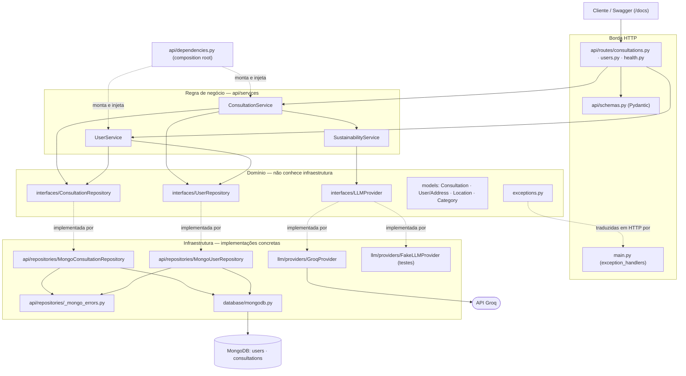
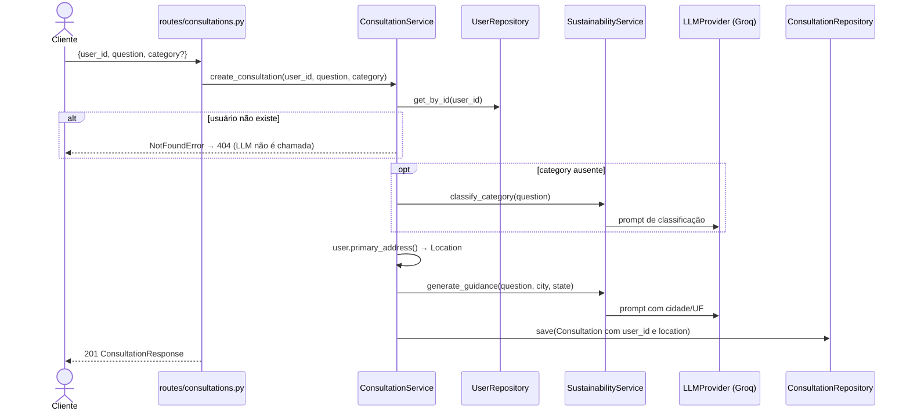

# Arquitetura do backend

API FastAPI que recebe dúvidas de sustentabilidade, gera uma orientação com uma LLM
(Groq) contextualizada pela cidade do usuário e guarda tudo no MongoDB, em duas
coleções relacionadas: `users` e `consultations`. Não há front-end: a demonstração é
feita pelo Swagger (`/docs`).

A modelagem do banco (documentos, relacionamento, subdocumentos, índices e a agregação
`$group`) está detalhada em [`DocMongoDB.md`](DocMongoDB.md). Este documento trata das
camadas da aplicação e de como elas conversam.

## Camadas



## Estrutura de pastas (`backend/app`)

```
main.py                     app FastAPI, registro das rotas e exception_handlers   (Pessoa 1)
api/
  routes/                   consultations.py, users.py, health.py                   (Pessoa 1)
  schemas.py                modelos Pydantic de request/response (só na borda)      (Pessoa 1)
  dependencies.py           composition root: liga interfaces às implementações     (Pessoa 1)
  services/
    consultation_service.py criar/listar/buscar/atualizar/remover consultas         (Pessoa 1)
    user_service.py         usuários, endereços, histórico, resumo, cascata         (Pessoa 1)
    sustainability_service.py  prompts de orientação e de classificação             (Pessoa 2)
  repositories/
    mongo_consultation_repository.py  coleção consultations                         (Pessoa 3)
    mongo_user_repository.py          coleção users                                 (Pessoa 3)
    _mongo_errors.py                  PyMongoError -> RepositoryError               (Pessoa 3)
domain/
  interfaces/               ConsultationRepository, UserRepository (Pessoa 3), LLMProvider (Pessoa 2)
  models/                   Consultation, User/Address, Location, Category          (Pessoa 3)
  exceptions.py             erros de domínio
llm/providers/              GroqProvider, FakeLLMProvider                           (Pessoa 2)
database/mongodb.py         cliente e conexão com o MongoDB                         (Pessoa 3)
core/config.py              variáveis de ambiente (Settings)
```

## Regra de dependência

`api/routes` → `api/services` → **interfaces** do `domain`.

- Os services recebem `ConsultationRepository`, `UserRepository` e `LLMProvider`
  (classes abstratas) no construtor. Nenhum service importa `pymongo`,
  `langchain_groq` ou uma classe concreta.
- O `domain` não importa nada de infraestrutura.
- O único lugar que conhece as implementações reais (`MongoConsultationRepository`,
  `MongoUserRepository`, `GroqProvider`) é o **composition root**,
  [`app/api/dependencies.py`](../app/api/dependencies.py), via `Depends` do FastAPI.
- As rotas não têm `try/except`: os erros de domínio são convertidos em status HTTP em
  um único ponto, nos `exception_handlers` do [`app/main.py`](../app/main.py).

É isso que sustenta o critério de POO/abstração: trocar o banco ou o provider de LLM
significa escrever outra implementação da interface e mudar uma linha em
`dependencies.py`. Também é o que permite testar a regra de negócio sem MongoDB e sem
chave da Groq.

## Fluxo de `POST /consultations`



1. A rota valida o corpo com `ConsultationRequest` (`user_id` obrigatório, `category` opcional).
2. `ConsultationService` busca o usuário **antes** de chamar a LLM: um `user_id`
   inexistente devolve 404 sem custo de API.
3. Sem `category`, `SustainabilityService.classify_category` pede à LLM uma das
   categorias do enum `Category`; resposta fora da lista vira `LLMProviderError` (502).
4. O endereço principal do usuário (`User.primary_address()`) vira um `Location`, que
   entra no prompt de `generate_guidance` e é salvo na consulta como snapshot.
5. A `Consultation` (imutável) é salva com `user_id` (referência a `users._id`) e
   `location`; a rota responde 201 com `ConsultationResponse`.

## Fluxo de `DELETE /users/{user_id}` (integridade referencial)

`UserService.delete_user`:

1. `get_user(user_id)` — 404 se não existir (a cascata nem começa);
2. `ConsultationRepository.delete_by_user(user_id)` — apaga as consultas do usuário;
3. `UserRepository.delete(user_id)` — apaga o usuário.

O MongoDB não roda essas duas operações em transação aqui, então a ordem importa: as
consultas saem antes do usuário. Se algo falhar no meio, sobra no máximo um usuário sem
consultas — nunca consultas órfãs apontando para um usuário inexistente.

## Endpoints

| Método | Caminho | Service | Sucesso | Erros |
|---|---|---|---|---|
| GET | `/health` | — (ping no MongoDB) | 200 | 503 |
| POST | `/consultations` | `ConsultationService.create_consultation` | 201 | 404, 422, 502, 503 |
| GET | `/consultations` | `ConsultationService.list_consultations` | 200 | 422, 503 |
| GET | `/consultations/{consultation_id}` | `ConsultationService.get_consultation` | 200 | 404, 503 |
| PATCH | `/consultations/{consultation_id}` | `ConsultationService.update_consultation_category` | 200 | 404, 422, 503 |
| DELETE | `/consultations/{consultation_id}` | `ConsultationService.delete_consultation` | 204 | 404, 503 |
| POST | `/users` | `UserService.create_user` | 201 | 409, 422, 503 |
| GET | `/users` | `UserService.list_users` | 200 | 422, 503 |
| GET | `/users/{user_id}` | `UserService.get_user` | 200 | 404, 503 |
| POST | `/users/{user_id}/addresses` | `UserService.add_address` | 201 | 404, 422, 503 |
| DELETE | `/users/{user_id}` | `UserService.delete_user` (cascata) | 204 | 404, 503 |
| GET | `/users/{user_id}/consultations` | `UserService.list_consultations` | 200 | 404, 503 |
| GET | `/users/{user_id}/consultations/summary` | `UserService.summarize_consultations` (`$group`) | 200 | 404, 503 |

## Tratamento de erro

| Exceção / situação | Onde nasce | Quem traduz | Status |
|---|---|---|---|
| `NotFoundError` | services (consulta ou usuário inexistente) | handler em `main.py` | 404 |
| `ConflictError` | `MongoUserRepository.save` (`DuplicateKeyError` no índice único de e-mail) | handler em `main.py` | 409 |
| `LLMProviderError` | `GroqProvider` (falha, resposta vazia ou inválida) e `classify_category` (categoria fora do enum) | handler em `main.py` | 502 |
| `RepositoryError` | repositórios Mongo, via `translate_errors` em `_mongo_errors.py` (qualquer `PyMongoError`) | handler em `main.py` | 503 |
| Corpo/parâmetro inválido | validação Pydantic em `schemas.py` | FastAPI | 422 |
| MongoDB fora no `GET /health` | `routes/health.py` (`ping` + `PyMongoError`) | a própria rota | 503 |

`DuplicateKeyError` também é um `PyMongoError`; por isso `MongoUserRepository.save` o
captura antes do `translate_errors`, para virar regra de negócio (409) e não falha de
banco (503).

## Testes

- **Services** são testados com fakes em memória das interfaces e com
  `FakeLLMProvider` — sem banco e sem chamar a Groq.
- **Rotas** são testadas com `TestClient` e `app.dependency_overrides`: o
  `get_database` é trocado por um `mongomock`, então as requisições passam pelos
  repositórios Mongo reais (índice único, `$group`).
- **Integração com MongoDB real** roda no CI (`.github/workflows/tests.yml`, serviço
  `mongo:7`). Localmente esses testes são pulados quando não há Mongo acessível.
- O CI publica a tabela de cobertura no resumo do run e o relatório HTML/XML como
  artifact `coverage-report`. O `pytest.ini` exige no mínimo 80%.

Detalhes em [`testes.md`](testes.md).

## Decisões

- **Duas coleções com referência + subdocumentos**: `consultations.user_id` referencia
  `users._id`; `users.addresses` é lista de subdocumentos; `consultations.location` é
  um snapshot do endereço usado na resposta. Justificativas em [`DocMongoDB.md`](DocMongoDB.md).
- **Integridade referencial na aplicação**: criar consulta exige usuário existente e
  remover usuário remove as consultas dele — regras no `ConsultationService` e no `UserService`.
- **Um único provider real de LLM (Groq)**, atrás da interface `LLMProvider`. Trocar
  de provider é escrever outra implementação; sem LangGraph nem múltiplos agentes.
- **PyMongo síncrono** (não Motor): as interfaces são síncronas e o FastAPI roda rotas
  `def` em threadpool. Simplicidade proporcional à PoC.
- **Sem ODM**: mapeamento manual `_to_document`/`_to_entity` nos repositórios.
- **Entidades imutáveis** (`@dataclass(frozen=True)`): "atualizar" gera nova instância
  (`dataclasses.replace`, `User.with_address`).
- **`_id` = UUID gerado pela aplicação**, não `ObjectId` — um único identificador por registro.
- **Erros de domínio, não de biblioteca**: services e rotas só conhecem as exceções de
  `domain/exceptions.py`; nada de `PyMongoError` ou erros da Groq acima da infraestrutura.
